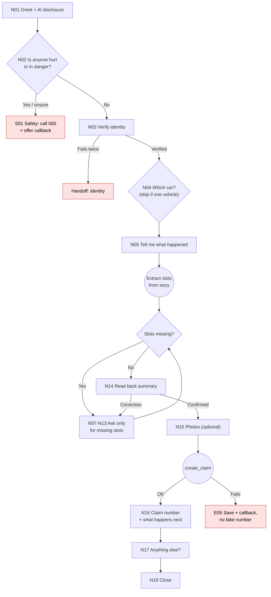
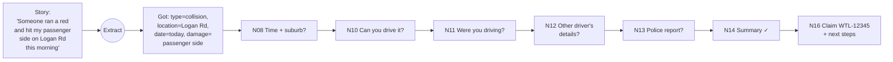
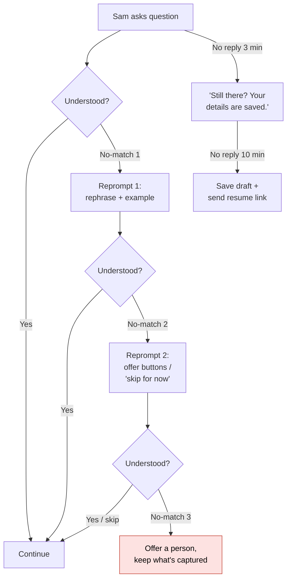
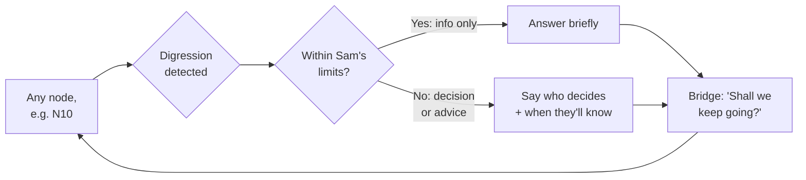
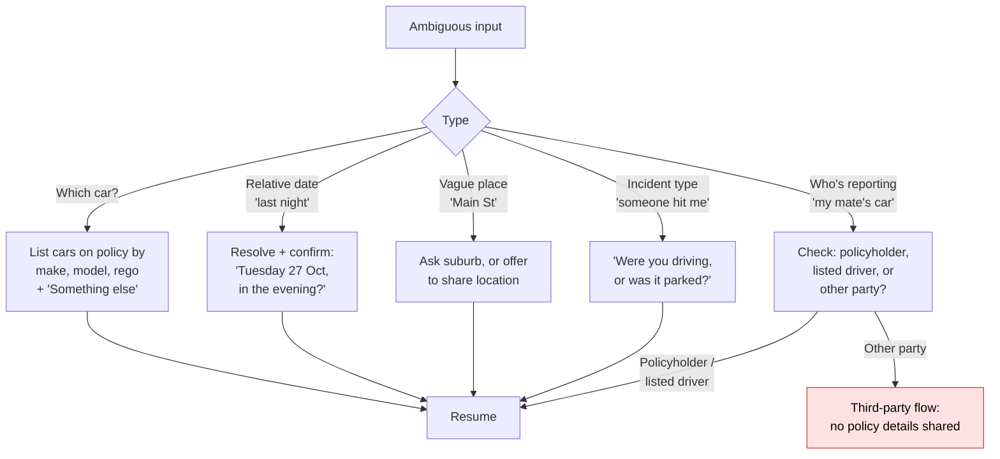

# Conversation flows

Diagrams are Mermaid and render on GitHub. Node IDs (e.g. `N03`) match the prompt inventory in [03-dialogue-scripts.md](03-dialogue-scripts.md).

**Legend:** rectangles are Sam's turns, diamonds are decisions, rounded boxes are system actions, red is an exit to a human.

## 1. Master flow

**Global listeners** (active on every node): ask for a human, complaint, injury mentioned, vulnerability cue, digression question, "stop / later". See sections 4-6.

## 2. Happy path: collision with another vehicle

Slots: `vehicle`, `incident_type`, `date_time`, `location`, `description`, `drivable`, `driver`, `other_party`, `police_ref`.

Story-first means a good opening message can fill four or five slots at once, so the customer answers three or four questions instead of ten.

## 3. Error handling

### No-match and no-input (any question node)

### System and validation errors

| ID | Situation | Behaviour |
|----|-----------|-----------|
| E01 | Date in the future, or more than 12 months ago | Check, don't reject: "Just checking: was that 3 June this year?" |
| E02 | Rego doesn't match format | Accept it, flag `unverified`. Don't block a claim on a typo. |
| E03 | `get_policy` down | Continue capture without policy details; tell the customer the consultant will confirm cover details. |
| E04 | `verify_identity` down | Capture the story and contact details only; handoff with "identity not verified". |
| E05 | `create_claim` fails | Never invent a number. Save the draft, book a callback, say so plainly. |
| E06 | Customer contradicts an earlier answer | Ask once which is right. Don't accuse. |

## 4. Digressions: answer, bridge, resume

The customer asks something off the current path. Sam answers within its limits, then returns to the exact node it left.

| Digression | Sam can say | Sam must not say |
|------------|-------------|------------------|
| "Is my excess covered?" / "How much is my excess?" | The excess on the policy schedule; that some excesses can be waived and the consultant confirms | "You'll pay $X" / "You won't pay excess" |
| "Will you cover this?" | What the policy type is (e.g. comprehensive); that cover is confirmed during assessment | "Yes, you're covered" |
| "Am I at fault?" | Fault is assessed from the details; general tip: don't admit fault at the scene | Any view on fault |
| "Can I get a hire car?" | Whether hire car cover is listed on the policy; consultant arranges it | "We'll get you a car today" |
| "Will my premium go up?" | Premiums are reviewed at renewal; can't predict | Any yes/no |
| "Should I claim or pay myself?" | Customer's choice; offers to note the incident without lodging, or a person to talk it through | A recommendation (personal advice) |
| "Where's my car being towed?" | Tow details if `book_tow` was used | A guess |

Two digressions in a row on cover or money, or any sign of confusion about cover, triggers an offer of a person.

## 5. Disambiguation

**Rules:** offer 2-4 options, most likely first, always with an escape ("Something else"). Never guess silently on anything that changes the claim (vehicle, date, incident type). Confirm resolved dates as a full date.

## 6. Escalation to a human

| Trigger | Detected by | Sam says / does |
|---------|-------------|-----------------|
| Anyone hurt, in danger, or unsure | N02 answer, or injury words anywhere | 000 first, then callback. Stops claim capture. |
| Customer asks for a person | "agent", "human", "real person", "call me" | Honour at once. One sentence on what's saved. No "are you sure?". |
| Complaint or dissatisfaction | "not happy", "complain", "ridiculous", "useless" | Acknowledge, log as a complaint, offer a person. Don't argue or defend. |
| Vulnerability cues | Mentions of family violence, financial hardship, disability, language difficulty, severe distress | Empathy level 3, offer a person, flag `vulnerability` in handoff (no label shown to customer). |
| Third party claiming against a customer | Disambiguation W | Third-party team. No policyholder data shared. |
| Three no-matches on one node | Error flow | Offer a person, keep the draft. |
| Question needing a decision or advice | Digression table | Explain who decides; offer a person if they want it now. |
| Possible fraud signals | Back-end rules only | No change to the conversation. Flag silently for the claims team. Never accuse. |

The handoff payload is specified in [06-nlu-and-handoff-spec.md](06-nlu-and-handoff-spec.md).
