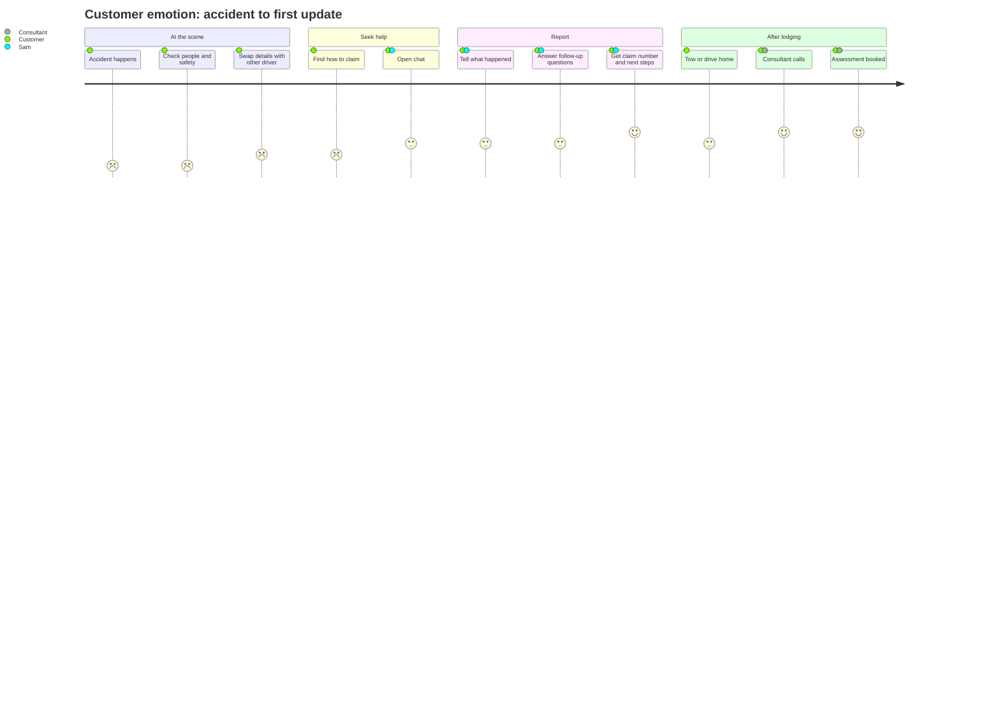

# Journey map

## Customer journey: car accident to first update

Emotion scores run 1 (worst) to 5 (best).

| Stage | Doing | Thinking | Feeling | Pain points | AI opportunity | Must be human |
|-------|-------|----------|---------|-------------|----------------|---------------|
| **At the scene** | Checking for injuries, moving off the road, swapping details | "Is everyone OK? What do I need to get?" | Shock, fear, adrenaline | Forgets to get details; doesn't know what to collect | Short checklist via app ("what to collect at the scene"); tow booking | Emergency services |
| **Seek help** | Searching the app or website, finding the policy number | "Where do I even start? Where's my policy?" | Anxious, impatient | Policy number buried; long phone queues | Chat on the claims page; identity by mobile and DOB instead of policy number | – |
| **Report (FNOL)** | Describing the incident, answering questions | "Am I covered? Will I pay the excess? Was it my fault?" | Worried, wants certainty | Repeating the story; forms built for the insurer, not the customer | Story-first capture; asks only for gaps; answers digressions within limits | Anything about cover decisions, fault, injury or complaints |
| **Next steps** | Arranging a tow, hire car, getting home | "How long without a car? Who pays the tow?" | Frustrated, practical | Not knowing what happens next or when | Clear next step with a time ("within 1 business day"); SMS summary | Hire car approval |
| **Wait and update** | Waiting for the consultant's call, sending photos | "Has anyone looked at it?" | Uncertain | Silence; chasing for updates | Proactive status messages; photo upload link | The consultant call itself |

**Biggest friction to remove:** telling the story twice. The handoff summary (see [06-nlu-and-handoff-spec.md](06-nlu-and-handoff-spec.md)) targets this directly.

## Claims consultant journey: receiving a handoff

| Stage | Today (assumed) | With Sam + co-pilot |
|-------|-----------------|---------------------|
| **Receive** | Call arrives cold; asks the customer to start from the beginning | Handoff card shows summary, filled slots, missing slots, flags (distress, vulnerability, hit-and-run) |
| **Understand** | Reads free-text notes, re-asks questions | Reads a 5-line summary; sees the customer's original words |
| **Act** | Manually keys data into the claims system | Draft claim pre-filled; consultant reviews and confirms |
| **Follow up** | Writes the call note | Co-pilot drafts the note; consultant edits and saves |

**Design principle for the co-pilot:** it drafts and summarises; the consultant decides. Every AI-filled field is marked as AI-captured until a person confirms it.
