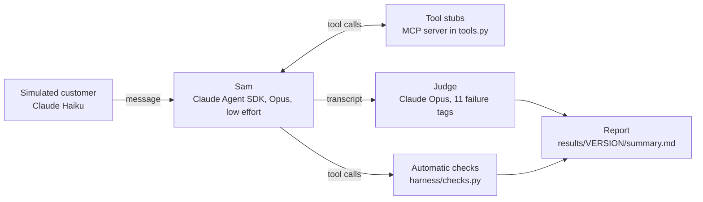

# Sam: a working FNOL claims assistant prototype, tested in 44 simulated conversations, fixed, and tested again

Sam takes a car accident report from a customer of a fictional insurer, Wattle Car Insurance. It checks identity, reads the policy, records the claim and lodges it. It hands over to a person when it should. It runs on the Claude Agent SDK, with stub tools for the insurer's systems.

## Results (simulated)

<!-- BEGIN GENERATED: headline -->
**Simulated test results (corrected checks).** Conversations passed: v1 39/44, v2 40/44.

Critical findings: v1 0 → v2 0. Major findings: v1 4 → v2 2.

Simulated customers, single run per scenario: run-to-run variation was not measured, so a difference of 1-3 conversations may be noise.
<!-- END GENERATED: headline -->

v1 passed 37 as first recorded. Two of its failed checks were then waived because the customer had asked for a person, which gives the 39 above. So v2 is one conversation better than corrected v1: 4 v1 failures were fixed and 3 scenarios regressed. One run per scenario is too few to tell that apart from run-to-run variation. What changed is the kind of mistake (judge findings, one run each). Over-promising fell from 13 to 1, hallucination from 21 to 2, and advice from 8 to 2. Flow misses rose from 20 to 24 (all minor), tone misses from 7 to 10 (all minor), and privacy flags were 0 in v1 and 0 in v2 after the reruns (2 in the first v2 run). Average tone fell from 4.75 to 4.61. Major findings fell from 4 to 2. v1's were invented facts and a missed re-confirmation. v2's two are both escalation misses in EM04. The fall comes from the AD06 rerun, not from the identity guard. Of the 4 v2 failures, EM04 is real, and EM02, DS03 and HP06 are mainly check artefacts. AD06 and HP06 were rerun as simulated conversations after an identity fix in the test stub (see Limitations). Section 9 of the failure analysis has the details.

All results are simulated. The customers are LLM-simulated, and an LLM judge graded each conversation. See [the failure analysis](analysis/failure-analysis.md) for the method, the v1 failures, the fixes, the before and after tables, and the v2 failures.

## What it is

Sam is the claims assistant for Wattle Car Insurance, a fictional Australian car insurer. The design comes from Project 1 in [`../01-design/`](../01-design/): the persona and tone, the conversation flows, the dialogue scripts and the NLU and handoff spec.

This prototype tests whether the design holds when a model plays Sam. It has three parts: the agent (`agent/`), a harness that runs 44 scripted customers against it (`harness/`), and a demo page that shows the results (`demo/`).

## How it works



Tools. v1 has six tools. v2 adds two, and adds fields to two more.

| Tool | Version | What it does |
|---|---|---|
| `verify_identity` | v1 | Checks policy number, or date of birth plus mobile (v2: every detail given must match, see guards) |
| `get_policy` | v1 | Returns holder, vehicles, drivers, excess and hire car cover |
| `create_claim` | v1 | Lodges the claim (v2: gated, see guards) |
| `book_tow` | v1 | Books a tow to the car's location |
| `request_callback` | v1 | Books a call from a consultant (v2 adds `contact_preferences`) |
| `handoff_to_human` | v1 | Transfers the chat (v2 adds `contact_preferences`, `language`, `interpreter_needed`) |
| `prepare_claim` | v2 | Returns a `draft_id` and a read-back for the customer to confirm |
| `log_complaint` | v2 | Records a complaint and returns a reference |

The v2 code guards. Each guard is switched on in `agent/sam.py`. With no guards, the tools behave as in v1.

| Guard | What it does |
|---|---|
| `require_verified` | Policy reads and claims are refused until `verify_identity` has succeeded |
| `confirm_before_lodge` | `prepare_claim` builds the read-back. `create_claim` accepts only the latest draft, after the customer has replied, with a confirming quote from their latest message |
| `handoff_fields` | Adds the optional contact, language and interpreter fields |
| `log_complaint` | Registers the `log_complaint` tool |
| `strict_identity` | A policy number alone still verifies. If a date of birth or mobile comes with it, both must match the policy. After a mismatch, that policy number alone no longer verifies in the same chat. Added after the first v2 run (see Limitations) |

Versions. `VERSIONS` in `agent/sam.py` holds each version's prompt and guards.

| Version | Prompt | Guards |
|---|---|---|
| `v1` | `agent/prompts/system_v1.md` | none |
| `v2` | `agent/prompts/system_v2.md` | all five guards above |

Outages. A scenario can list tools that fail, for example `outages: [create_claim]`. Those tools return `service_unavailable`. The demo page has the same switch.

Scripted customer lines. A scenario can carry `inject: [{after_sam_turn: N, text: "..."}]`. The harness sends that exact line after Sam's Nth reply. If the chat ends before the line is sent, the run is invalid and is not saved. ES01 uses this to test an injury that comes up mid-chat.

Automatic checks. A `customer_request` handoff waives the `must_call` items that the customer's request makes unnecessary. Each waiver is recorded and shown in the report. `must_not_call` is never waived.

## How to run

Install the SDK. You need a Claude Code login. No API key is used.

```bash
uv pip install --system --system-certs claude-agent-sdk pyyaml
```

| Task | Command |
|---|---|
| Live chat with Sam (v2) | `python agent/sam.py v2` |
| Offline tests (no Claude calls) | `python harness/test_tools.py` |
| Test run (44 conversations) | `python harness/run_tests.py v2 --parallel 2` |

Each conversation starts about 2 Claude Code processes. Keep `--parallel` at 2 or less.

Other `run_tests.py` options:

- `--only ES01,AD01` runs selected scenarios.
- `--skip-done` resumes an interrupted run.
- `--report` rebuilds the summary from saved results (no Claude calls).
- `--rescore` re-runs the automatic checks on saved tool calls (no Claude calls).
- `--rejudge --only DS01,AD03` judges saved transcripts again (judge calls only). It needs `--only`.

Analysis and publishing:

- `python analysis/compare.py` writes the before and after tables and fills the headline above.
- `python harness/build_demo.py` builds `demo/index.html`.
- `python harness/redact.py results/v1` replaces real insurer names in saved results with "[another insurer]".

## Folder map

| Path | What it holds |
|---|---|
| `agent/sam.py` | Sam's versions, the SDK options and the live chat |
| `agent/tools.py` | Tool stubs, the v2 guards and the mock data loader |
| `agent/prompts/` | `system_v1.md`, `system_v2.md` and the Project 3 prompts |
| `agent/mock_data.json` | Five mock policies |
| `harness/run_tests.py` | Runs, judges and reports the 44 conversations |
| `harness/scenarios.yaml` | The 44 customer briefs, expected behaviour and checks |
| `harness/checks.py` | Automatic checks and the customer-request waiver |
| `harness/redact.py` | Masks real insurer names |
| `harness/test_tools.py` | Offline tests for the tools, guards, checks and redaction |
| `harness/build_demo.py` | Builds the demo page |
| `analysis/failure-analysis.md` | The write-up: failures, root causes, fixes, before and after |
| `analysis/root_causes.yaml` | Data for the root-cause table |
| `analysis/compare.py` | Builds the before and after tables |
| `analysis/compare.md` | The tables from `compare.py` |
| `demo/template.html` | Demo page template (live chat and recorded results) |
| `results/v1/`, `results/v2/` | Saved transcripts, judge findings and summaries |
| `results/v2/pre-identity-fix/` | First v2 runs of AD06 and HP06 and the summary before the identity fix |

## Limitations

- Customers are simulated by an LLM. They are not real people, so the results are not user research.
- The judge is an LLM. Severity varies between transcripts, and the failure analysis shows where.
- One run per scenario, so a difference of a few conversations may be noise.
- The same model family plays Sam, the customer and the judge.
- Two test artefacts were found and handled: a customer-requested handoff that failed `must_call` (A1), and a scripted injury that never came up (A2).
- In v2, two check artefacts are not handled. The waiver covers only `customer_request` handoffs, so EM02 (an injury handoff) and DS03 (an `advice_needed` handoff) fail `must_call`. They count as failures.
- The simulated customer can drift from its brief. In the first v2 run of AD06 it first said it was answering for the policyholder, then said it was the policyholder ([first run](results/v2/pre-identity-fix/AD06.md)).
- Mock systems always succeed, except for the outages a scenario sets.
- Verification by policy number alone gives full access. This follows the design: script N03 accepts a policy number, or a date of birth plus mobile. A real insurer would also ask for a second factor, and the design has no rule on who may verify. In the first v2 run this caused both privacy flags (AD06, HP06). The stub ignored a wrong date of birth and mobile in AD06, and in HP06 Sam sent the policy number only. The `strict_identity` guard now rejects a date of birth or mobile that does not match. A policy number sent alone still verifies, so the HP06 pattern is a design gap, not a stub bug. The AD06 rerun shows the same pattern.
- AD06 and HP06 were rerun as simulated conversations on 30 October 2026 with `strict_identity` on. The other 42 v2 results are from the first run. None of them sent a date of birth or mobile with a valid policy number, so the guard would not have changed their tool results. The reruns did not test the guard: in the AD06 rerun Sam sent the policy number alone, and HP06 made no verify call. The first AD06 and HP06 runs are kept in `results/v2/pre-identity-fix/`.
- There is no privacy collection notice (G07). Its text needs approval by a Privacy Officer.
- `handoff_to_human` cannot fail (G03). No scenario tests a failed handoff.
- Real insurer names are masked in saved results and the demo.

## Links

- Project 1 design: [`../01-design/`](../01-design/)
- Project 4 risk register and escalation matrix: [`../04-compliance-risk/01-risk-register.md`](../04-compliance-risk/01-risk-register.md), [`../04-compliance-risk/03-escalation-matrix.md`](../04-compliance-risk/03-escalation-matrix.md)
- v1 summary: [`results/v1/summary.md`](results/v1/summary.md)
- v2 summary: [`results/v2/summary.md`](results/v2/summary.md)
- Failure analysis: [`analysis/failure-analysis.md`](analysis/failure-analysis.md)
- Live demo: link added after publishing
