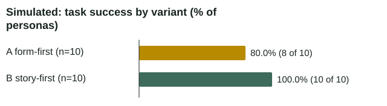
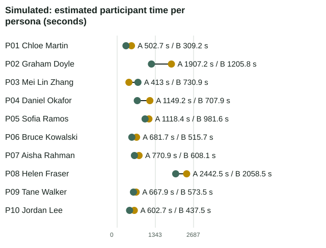
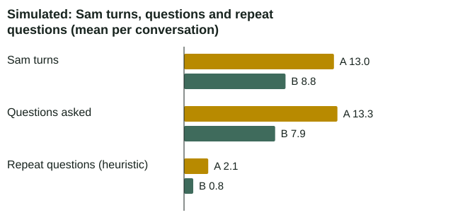
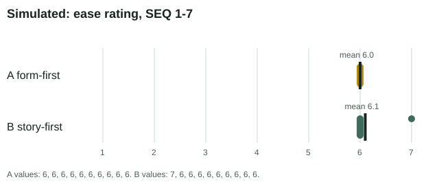
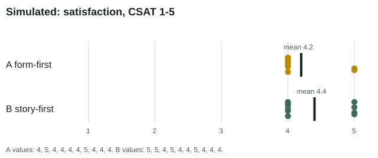
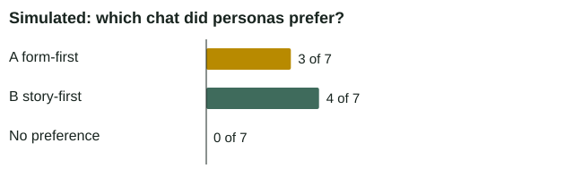

<!-- Generated by build_report.py. Edit the template there, not this file. -->
# Project 3: story-first vs form-first (simulated pilot)

> **SIMULATED PILOT. Participants are LLM personas, not real people. This de-risks the study design; it is not user research.**

20 of 20 conversations complete. 

## Summary (simulated)

- Task success: A 80.0% (8 of 10); B 100.0% (10 of 10).
- Estimated participant time (modelled from word counts, not measured), mean seconds: A 1025.6, B 812.9.
- Sam turns, mean: A 13, B 8.8. Questions asked, mean: A 13.3, B 7.9. Repeat questions (keyword heuristic), mean: A 2.1, B 0.8.
- Ease, SEQ 1 to 7, mean: A 6, B 6.1. Satisfaction, CSAT 1 to 5, mean: A 4.2, B 4.4.
- Preference: A 3, B 4, no preference 0 (of 7 personas; no preference recorded for P04, P05, P06).

> **Recommendation (rule written before the run)** Simulated pilot result: variant B (story_first) had task success for 10 personas against 8, out of 10 paired personas. Confirm with the real study before changing the design. This simulated pilot tests the study design. It does not show how real people behave. Read this result with care. It comes from 10 simulated personas, and a gap of 2 personas is small: one changed outcome would put it below the rule's threshold. Both of A's misses were on one fact, whether the car is safe to drive, and neither was an error by Sam (see Limitations). If both had counted as successes, B would still win, but only on modelled time (21% less). This result is not evidence about real people. The real study should test it.

## What we tested

One variable changes: how Sam captures the claim. Everything else stays the same: the same model, tools, policies, personas and questionnaire. Variant A (form-first) asks each detail one at a time, in a fixed order. Variant B (story-first) lets the customer tell it in their own words, then asks only for the gaps. B is the Project 1 design. A is the comparison, written for this test.

| Variant A: form-first (line 24) | Variant B: story-first (line 24) |
|---|---|
| 5. Collect the details one at a time, in this fixed order: (1) date and time, (2) location (street and suburb), (3) type of incident, (4) who was driving, (5) whether the car can be driven safely, (6) a short description of what happened and the damage, (7) the other driver's details, (8) any police reference. Ask one short, direct question for each and move to the next once you have an answer. Don't invite the customer to tell the whole story first. If they have already mentioned a detail, confirm it when you reach it in the order ("You mentioned Logan Rd, Mount Gravatt. Is that right?") instead of skipping it. | 5. Ask them to tell you what happened in their own words. Extract as much as you can from their story, and only ask for what's missing. |

Why A confirms rather than skips: a guided form gives every field its own turn. That is the strategy under test. So when A reaches a detail the customer already gave, it confirms it ("You mentioned Logan Rd, Mount Gravatt. Is that right?") instead of skipping it.

Prompt files: `02-prototype/agent/prompts/system_ab_form.md` and `02-prototype/agent/prompts/system_ab_story.md`. Both are copies of `system_v1.md`; only line 24 differs.

## Method

**Hypothesis (written before the run, 28 October 2026):** story-first (B) needs fewer questions and less participant time than form-first (A), with equal or better task success. Form-first may capture facts more completely for vague or low-confidence personas.

### Simulated participants

Ten LLM personas, all fictional. Each runs both variants. Ages 19 to 83; digital confidence 5 high, 3 medium, 2 low.

| ID | Name | Age | Digital confidence | State | Incident | Order |
|---|---|---|---|---|---|---|
| P01 | Chloe Martin | 29 | high | calm | collision | AB |
| P02 | Graham Doyle | 71 | low | calm | storm | BA |
| P03 | Mei Lin Zhang | 34 | high | stressed | collision | AB |
| P04 | Daniel Okafor | 45 | medium | calm | parked_hit | BA |
| P05 | Sofia Ramos | 26 | high | worried | vandalism | AB |
| P06 | Bruce Kowalski | 58 | medium | irritated | single_vehicle | BA |
| P07 | Aisha Rahman | 19 | high | nervous | collision | AB |
| P08 | Helen Fraser | 83 | low | distressed | collision | BA |
| P09 | Tane Walker | 38 | medium | calm | windscreen | AB |
| P10 | Jordan Lee | 31 | high | calm | parked_hit | BA |

Counterbalancing: order AB means variant A runs first (5 personas), order BA means variant B runs first (5 personas). The order is fixed per persona, not randomised.

### Models

- Sam: `claude-opus-5-5` at low effort (sam.py).
- Simulated participants: `claude-haiku-5-5`.
- Judge: `claude-opus-5-5`. It grades Sam only and is never told the variant.

### Metrics

- Task success: a claim lodged with all key facts correct. For Helen Fraser (P08), a handoff or callback also counts.
- Facts correct: up to seven facts checked against the first successful create_claim call. The driver is not checked when nobody was driving (P02, P04, P05 and P10), so those personas have six.
- Questions asked: question sentences in Sam's turns.
- Repeat questions: keyword heuristic. Sam asks about a slot the customer already covered. The judge's count is shown for cross-check.
- Estimated participant time: word counts divided by the persona's reading and typing speed. A model, not a measure.
- SEQ (1-7) and CSAT (1-5): the simulated participant's answers after the chat.

### Decision rule (written before the run)

The same team wrote the plan, the prompts and this rule, and runs the test. The rule is fixed in `PLAN.md` before any full run. It is not registered with a third party.

n is the number of personas with both variants complete. With fewer than 6, there is no recommendation. All four rules use only personas with both variants complete.

- If task success differs by 2 or more personas, recommend the higher.
- Else, if mean estimated time differs by 15% or more (against the slower variant), and the faster variant's mean CSAT is not lower by more than 0.5, recommend the faster.
- Else, if one variant is preferred by at least 7 of 10 personas, recommend it.
- Else: no clear winner. Keep the current design (B) and let the real study decide.

## Results (simulated)

All results are simulated. Complete pairs: 10 of 10 personas.



*Share of personas whose task succeeded, by variant.*

| Variant | Task success |
|---|---|
| A form-first | 80.0% (8 of 10) |
| B story-first | 100.0% (10 of 10) |



*Modelled reading and typing time per persona, from word counts. Not measured. Each row is one persona; A and B are joined.*

| Persona | A (s) | B (s) |
|---|---|---|
| P01 Chloe Martin | 502.7 | 309.2 |
| P02 Graham Doyle | 1907.2 | 1205.8 |
| P03 Mei Lin Zhang | 413.0 | 730.9 |
| P04 Daniel Okafor | 1149.2 | 707.9 |
| P05 Sofia Ramos | 1118.4 | 981.6 |
| P06 Bruce Kowalski | 681.7 | 515.7 |
| P07 Aisha Rahman | 770.9 | 608.1 |
| P08 Helen Fraser | 2442.5 | 2058.5 |
| P09 Tane Walker | 667.9 | 573.5 |
| P10 Jordan Lee | 602.7 | 437.5 |



*Mean Sam turns, questions and repeat questions per conversation. Repeat questions use a keyword heuristic.*

| Measure | A | B |
|---|---|---|
| Sam turns | 13 | 8.8 |
| Questions asked | 13.3 | 7.9 |
| Repeat questions (heuristic) | 2.1 | 0.8 |



*SEQ ease rating per conversation (1 very difficult, 7 very easy). The tick is the mean.*

| Variant | Mean SEQ | n |
|---|---|---|
| A form-first | 6 | 10 |
| B story-first | 6.1 | 10 |



*CSAT satisfaction per conversation (1 very dissatisfied, 5 very satisfied). The tick is the mean.*

| Variant | Mean CSAT | n |
|---|---|---|
| A form-first | 4.2 | 10 |
| B story-first | 4.4 | 10 |



*Which chat each simulated persona said they would rather use.*

| Preference | Personas |
|---|---|
| A form-first | 3 |
| B story-first | 4 |
| No preference | 0 |

## Per conversation (simulated)

Repeat questions show the keyword heuristic first, then the judge's count. Each ID links to the transcript.

| Conversation | Persona | Variant | Success | Facts | Sam turns | Questions | Repeats (heur. / judge) | Est. seconds | SEQ | CSAT |
|---|---|---|---|---|---|---|---|---|---|---|
| [P01-A](results/simulated/transcripts/P01-A.md) | Chloe Martin | A | no | 6/7 | 14 | 14 | 1 / 2 | 502.7 | 6 | 4 |
| [P01-B](results/simulated/transcripts/P01-B.md) | Chloe Martin | B | yes | 7/7 | 9 | 9 | 0 / 0 | 309.2 | 7 | 5 |
| [P02-A](results/simulated/transcripts/P02-A.md) | Graham Doyle | A | yes | 6/6 | 11 | 11 | 1 / 2 | 1907.2 | 6 | 5 |
| [P02-B](results/simulated/transcripts/P02-B.md) | Graham Doyle | B | yes | 6/6 | 6 | 4 | 1 / 0 | 1205.8 | 6 | 5 |
| [P03-A](results/simulated/transcripts/P03-A.md) | Mei Lin Zhang | A | yes | 7/7 | 10 | 10 | 3 / 0 | 413.0 | 6 | 4 |
| [P03-B](results/simulated/transcripts/P03-B.md) | Mei Lin Zhang | B | yes | 7/7 | 9 | 7 | 1 / 0 | 730.9 | 6 | 4 |
| [P04-A](results/simulated/transcripts/P04-A.md) | Daniel Okafor | A | yes | 6/6 | 13 | 15 | 2 / 2 | 1149.2 | 6 | 4 |
| [P04-B](results/simulated/transcripts/P04-B.md) | Daniel Okafor | B | yes | 6/6 | 7 | 7 | 0 / 1 | 707.9 | 6 | 5 |
| [P05-A](results/simulated/transcripts/P05-A.md) | Sofia Ramos | A | yes | 6/6 | 13 | 14 | 2 / 1 | 1118.4 | 6 | 4 |
| [P05-B](results/simulated/transcripts/P05-B.md) | Sofia Ramos | B | yes | 6/6 | 10 | 10 | 0 / 0 | 981.6 | 6 | 4 |
| [P06-A](results/simulated/transcripts/P06-A.md) | Bruce Kowalski | A | yes | 7/7 | 12 | 12 | 3 / 1 | 681.7 | 6 | 4 |
| [P06-B](results/simulated/transcripts/P06-B.md) | Bruce Kowalski | B | yes | 7/7 | 8 | 7 | 2 / 0 | 515.7 | 6 | 4 |
| [P07-A](results/simulated/transcripts/P07-A.md) | Aisha Rahman | A | yes | 7/7 | 12 | 13 | 2 / 2 | 770.9 | 6 | 5 |
| [P07-B](results/simulated/transcripts/P07-B.md) | Aisha Rahman | B | yes | 7/7 | 12 | 11 | 0 / 1 | 608.1 | 6 | 5 |
| [P08-A](results/simulated/transcripts/P08-A.md) | Helen Fraser | A | yes | 7/7 | 16 | 16 | 3 / 3 | 2442.5 | 6 | 4 |
| [P08-B](results/simulated/transcripts/P08-B.md) | Helen Fraser | B | yes | 7/7 | 10 | 9 | 3 / 0 | 2058.5 | 6 | 4 |
| [P09-A](results/simulated/transcripts/P09-A.md) | Tane Walker | A | yes | 7/7 | 15 | 13 | 1 / 2 | 667.9 | 6 | 4 |
| [P09-B](results/simulated/transcripts/P09-B.md) | Tane Walker | B | yes | 7/7 | 9 | 8 | 1 / 0 | 573.5 | 6 | 4 |
| [P10-A](results/simulated/transcripts/P10-A.md) | Jordan Lee | A | no | 5/6 | 14 | 15 | 3 / 4 | 602.7 | 6 | 4 |
| [P10-B](results/simulated/transcripts/P10-B.md) | Jordan Lee | B | yes | 6/6 | 8 | 7 | 0 / 1 | 437.5 | 6 | 4 |

## What the simulated participants said (simulated)

### Form-first (A)

- P01 Chloe Martin (variant A): "It was quick and easy to get through. The questions were in a sensible order and the claim number came through at the end. I'd have liked a clearer heads-up on the tail-light check earlier, and the assistant didn't ask me about the other driver's insurer." (simulated)
- P02 Graham Doyle (variant A): "The assistant asked one simple question at a time, so I never felt rushed, and it was easy to answer without my policy number. It was clear what was needed and I knew where things stood by the end, with a claim number and a call coming within a business day." (simulated)
- P03 Mei Lin Zhang (variant A): "Pretty quick and it got the claim lodged without me having to dig through stuff with the kids going crazy. The tow being booked straight away was a big relief. Only thing I'd say is it asked for a few things twice and I didn't know the other street name, but it was fine." (simulated)
- P04 Daniel Okafor (variant A): "Pretty smooth. Sam asked one clear question at a time, and I could answer each one without digging for details. The only thing I noticed was being asked for my date of birth, which felt like a bit much when my policy number was enough, though Sam did say I didn't have to give it." (simulated)
- P05 Sofia Ramos (variant A): "Sam was polite and the questions were easy to answer one at a time, and the tow was booked quickly. I was worried about the car and I did not get the tow cost or know if I need to be there when the truck comes, but the consultant will follow up." (simulated)
- P06 Bruce Kowalski (variant A): "Quick and to the point, got the claim lodged and a tow booked without much fuss. Got asked the same things a couple of times though, which annoyed me a bit." (simulated)
- P07 Aisha Rahman (variant A): "Sam was patient and made it easy to follow one question at a time, and I didn't feel judged even though I kept apologising and worrying about being in trouble. The claim number and what happens next were clear, which helped me feel calmer about it." (simulated)
- P08 Helen Fraser (variant A): "Sam was patient and let me go one question at a time, which helped a lot while I was still shaking. I did lose track a few times and had to ask for the claim number again, but it was all written down clearly in the end." (simulated)
- P09 Tane Walker (variant A): "Pretty easy, mate. It asked one thing at a time and I didn't have to dig for anything, though it took me a minute to find the policy number. Didn't love that it kept asking about police and the truck, but I could just say no and it moved on." (simulated)
- P10 Jordan Lee (variant A): "Pretty straightforward. Sam asked clear questions one at a time and I got my claim lodged with a number. It was a bit repetitive, though: I gave my policy details, the car, the date and the location, and then had to confirm them again in the summary." (simulated)

### Story-first (B)

- P01 Chloe Martin (variant B): "Quick and simple. Sam asked one question at a time, I could answer each in a line, and the claim number came through at the end. Nothing confusing stood out." (simulated)
- P02 Graham Doyle (variant B): "Sam was patient and clear, asked one question at a time, and never made me feel silly for not having my policy number. I got my claim number written down and knew what would happen next, which was a relief." (simulated)
- P03 Mei Lin Zhang (variant B): "Pretty quick and easy once I gave the basics, and they got the tow booked and the claim lodged while I was still on the roadside. Felt a bit repetitive having to say the same details twice, and I wish it had asked about the kids' safety sooner, but overall it did what I needed." (simulated)
- P04 Daniel Okafor (variant B): "Really easy to get through. Sam asked one question at a time, the claim number and next steps were clear, and I was told a consultant would call within a business day. The only thing I'd have liked is a bit more detail on how the door repair gets sorted, but that's a small thing." (simulated)
- P05 Sofia Ramos (variant B): "Sam was calm and clear, and the claim was lodged quickly with a claim number and a tow booked. The part about excess was hard to understand at first, but Sam explained it with a simple example. I was worried about the car and glad someone was helping me." (simulated)
- P06 Bruce Kowalski (variant B): "Got the claim lodged without much fuss and the tow was sorted quick. Annoying that it asked me for the policy number again after I'd already given it, but the rest was straightforward." (simulated)
- P07 Aisha Rahman (variant B): "It was really easy to follow, Sam went one step at a time and never made me feel silly for not knowing things like the other car's make. I got my claim number and knew what to do next, which was a relief since I'd never done this before." (simulated)
- P08 Helen Fraser (variant B): "Sam was patient and let me go at my own pace, and the summary before lodging helped me feel sure it was all right. Some of the questions were a bit much when I was still shaking, but the tow being booked straight away was a real relief." (simulated)
- P09 Tane Walker (variant B): "Pretty easy, mate. Didn't have to dig much, it asked the right stuff and I got a claim number straight away. Only thing is I had to hunt for the policy number in my emails." (simulated)
- P10 Jordan Lee (variant B): "Quick and straightforward once I had the policy number. The only hiccup was the verification, where my date of birth and mobile didn't match and I had to dig out the policy number myself. After that the questions were clear and it was done in a few minutes." (simulated)

## Limitations

- The participants are LLM personas, not people. They are simulated and cannot show real confusion, distress or trust.
- The same model family plays Sam, the participants and the judge. Their blind spots may match.
- LLM raters tend to score chats positively. Read the ease and satisfaction scores as relative only.
- No memory between a persona's two chats, so order effects cannot appear here. Counterbalancing in this pilot only rehearses the protocol.
- The repeat-question count is a keyword heuristic. The keyword heuristic and the judge agree on which variant repeats more questions.
- Estimated participant time is modelled from word counts, not measured.
- n = 10 simulated personas. Complete pairs: 10. With n this small, a gap of 2 personas in task success is small.
- No conversation reached the 20-turn cap.
- Form-first's prompt tells Sam to ask each detail in turn and to confirm details already given. So some of A's extra questions and repeat questions are built into its prompt, not discovered by the test. The test compares two prompt texts that carry two strategies. It does not isolate the strategy from its wording.
- Estimated time comes from word counts, so it rises with the length of Sam's messages. That is also a prompt effect.
- The repeat-question heuristic uses broad keywords such as 'today', 'saturday' and 'night'. For vague personas (P05, P09), a fair follow-up for a precise time counts as a repeat. This penalises story-first's gap questions more, so it works against the hypothesis. Compare with the judge's count.
- Simulated participants can drift from their brief. In P01-A, Chloe's brief says the car drives fine. When Sam asked about the tail-lights, she said: "I haven't checked the tail-lights closely yet, so I'm not sure whether they're working." She then said "I'm at the lights right now", although the crash was that morning, and took it back a turn later: "Sorry, I shouldn't have said I was at the lights." Sam recorded drivable as "unsure", and she confirmed the summary. The facts check expects "yes", so this counts as a failure. The drift is the persona's. But the first doubt came from variant A's form question about the tail-lights, so this miss is partly the test design.
- The facts check can mark a careful answer as wrong. In P10-A, Jordan's car has a broken headlight. Sam asked: "With the broken headlight, do you feel the car is safe to drive, including at night?" Jordan said: "Not really sure about night driving." Sam recorded "unsure" and noted daylight only. The ground truth allows only "yes", so this counts as a failure. In P10-B, story-first Sam said "a headlight is broken, and the car is safe to drive" without asking, and that counts as a success. The customer had only said "It still drives fine." This is a real Sam error that the metric did not catch.
- A's two task failures (P01-A, P10-A) are the only facts misses in the run. Both are on the same fact, drivable, and both followed A's fixed safe-to-drive question. Neither is a Sam error. If both had counted as successes, task success would be 10 against 10 and rule 1 would not fire. Rule 2 would then pick B on estimated time (813 s against 1026 s, 21% less, with CSAT 4.4 against 4.2). That time is modelled, not measured. So B stays the recommendation under the rule, but the evidence for it is weak.
- Preferences were recorded for 7 of 10 personas. None was recorded for P04, P05, P06. The preference result is incomplete. Rule 3 was not reached, so it did not change the recommendation.

Decision rule, as applied: Simulated pilot result: variant B (story_first) had task success for 10 personas against 8 (paired personas only). Confirm with the real study before changing the design.

## Next: the real study

This pilot tests the study design. It does not show how real people behave. The real study uses 8 to 10 people, the same two variants and two task cards. Read the kit at [real-study-kit/README.md](real-study-kit/README.md). Confirm the result with the real study before changing the design.

Changes after the simulated pilot are recorded in the kit's README once the run is complete.

## Data and files

Generated 2026-10-30T06:32:13+10:00 by build_report.py. Data source: simulated. Files: [ab_results.csv](results/simulated/ab_results.csv), [ab_results.json](results/simulated/ab_results.json), [ab_preferences.csv](results/simulated/ab_preferences.csv).

## How to reproduce

Run from `03-usability-ab/`:

```
python run_ab.py --all --parallel 2   # resumable: re-run the same command after an interruption
python build_report.py
python test_metrics.py
```

Links: [report.html](report.html) (the same content on one page) and [real-study-kit/README.md](real-study-kit/README.md) (the real study).

## Files

| File | What |
|---|---|
| `personas.yaml` | The 10 simulated personas (fictional) |
| `ab_policies.json` | 12 fictional policies, merged into the tools at runtime |
| `metrics.py` | Pure metric functions and the decision rule (no SDK import) |
| `run_ab.py` | Runs the simulated conversations, judge and preferences |
| `build_report.py` | Writes the CSV, JSON, charts, this README and `report.html` |
| `test_metrics.py`, `tests/fixture_P01-A.json` | Offline tests for metrics.py |
| `chat_variant.py` | Terminal chat for the real study (blind to the variant) |
| `real-study-kit/` | The ready-to-run kit for 8 to 10 real participants |
| `../02-prototype/agent/prompts/system_ab_story.md` | Variant B prompt (story-first) |
| `../02-prototype/agent/prompts/system_ab_form.md` | Variant A prompt (form-first) |
| `results/simulated/` | Simulated run outputs: transcripts, preferences, CSV, JSON |
| `charts/*.svg` | The six charts |

Portfolio exercise. Simulated data only. Not research with real people.
